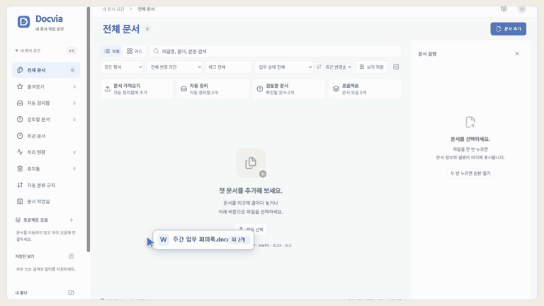

# DocBogi (독보기)

**업무 문서를 정리하고, 검색하고, 검토하는 데스크톱 앱.**

PDF, Word, PowerPoint, Excel, 한글 문서를 내 PC의 보관함에 모으세요. 파일명과 본문으로 찾아 요약과 오탈자 후보를 확인하고, 문서 작업실에서 고친 내용을 새 파일로 저장할 수 있습니다.

[다운로드](https://jungyuoo.github.io/DocBogi-downloads/#downloads) · [사용 가이드](user-guide.md) · [지원 형식](#지원-형식)

데모에는 예제 문서와 이름 변경 전 화면을 사용했습니다. [전체 영상 재생](media/docvia-intro.mp4)

## 설치

| 운영체제 | 설치 파일 | 설치 방법 |
| --- | --- | --- |
| Windows x64 | [EXE 다운로드](https://github.com/JungyuOO/DocBogi-downloads/releases/download/v1.1.2/Docvia-Setup-1.1.2-x64.exe) | EXE를 열고 설치 마법사를 진행합니다. |
| macOS · Apple Silicon 및 Intel | [공용 DMG 다운로드](https://github.com/JungyuOO/DocBogi-downloads/releases/download/v1.1.2/Docvia-1.1.2-mac-universal.dmg) | DMG를 열어 앱을 **응용 프로그램**으로 옮겨 실행합니다. |

**v1.1.2 수정 배포 · 2026-11-25.** 사내 Qwen의 업무대장 추출과 근거 확인, 좁은 화면의 작업실 도구 모음을 개선했습니다. 기존 v1.1.2 사용자는 위 설치 파일을 다시 받아 갱신할 수 있습니다.

v1.1.2 설치 파일과 실행 화면에는 이전 이름인 Docvia가 표시됩니다. 배포 파일의 SHA-256은 릴리스에 있습니다. 첫 실행 때 Windows SmartScreen이나 macOS Gatekeeper가 표시되면 사용 가이드의 설치 항목을 확인하세요. [릴리스 및 SHA-256](https://github.com/JungyuOO/DocBogi-downloads/releases/tag/v1.1.2) · [설치 안내](user-guide.md#설치하고-보관함-만들기)

## v1.1.2에서 메뉴 찾기

**전체 문서 · 최근 문서 · 즐겨찾기 · 자동 정리함 · 검토할 문서 · 문서 작업실** 바로 아래에 **내 폴더**가 있습니다. 프로젝트 모음과 저장된 보기는 폴더 아래에서 열 수 있습니다.

| 할 일 | 열 위치 |
| --- | --- |
| 계약대장을 작성하거나 기한을 추적하고 자동화 규칙을 실행하기 | 왼쪽에서 **업무 도구**를 펼쳐 **업무대장**, **기한·알림**, **업무 자동화**를 선택 |
| 새 문서를 분류할 규칙 편집하기 | **자동 정리함 → 자동 분류 규칙** |
| 진행 중이거나 실패한 작업 확인하기 | 하단 상태 표시줄의 **처리 현황** |
| 프로젝트의 자료와 업무 내용을 전달하기 | **프로젝트 모음 → 프로젝트 선택 → 인수인계 만들기** |

[v1.1.2 문서함 화면](media/library-112.webp)

## 빠른 시작

1. DocBogi를 실행하고 **보관함 위치 선택**에서 저장할 위치를 고릅니다.
2. 왼쪽 **내 폴더 → 보관함** 아래에 **회의록**, **운영 계획**, **업무 일정** 폴더를 만듭니다.
3. **전체 문서**에서 **문서 추가**를 누르거나 아래 예시처럼 업무 파일을 끌어 놓습니다. 처음에는 대상 폴더를 열고 파일을 추가해 직접 정리해 보세요.
4. 검색창에 **회의록**을 입력하고 문서를 선택합니다. AI를 연결했다면 **요약·검수 실행**을 누르고 오른쪽 **요약**, **검수** 탭에서 결과를 확인합니다.
5. 회의록 문구를 고치려면 **문서 작업실**에서 문서를 열고 **문단 직접 수정 → 초안에 적용 → 문서 사본 저장**을 사용합니다. 사본은 원본 문서와 같은 형식으로 저장됩니다.

| 가져오는 파일 예시 | 보관할 폴더 예시 |
| --- | --- |
| 주간 업무 회의록.docx | 회의록 |
| 분기 운영 계획.pptx | 운영 계획 |
| 업무 일정표.xlsx | 업무 일정 |

이후 같은 종류의 파일을 반복해서 정리하려면 기본 AI의 **연결 테스트**를 완료하고 **새로 가져오는 문서 자동 AI 분석**, **새 문서 자동 폴더 정리** 설정을 확인합니다. 충분한 근거가 있으면 기존 추천 폴더로 이동합니다. 직접 지정한 위치는 유지되며 분류가 불확실하거나 분석이 일부만 끝난 문서는 **검토할 문서**에서 확인합니다.

## 문서가 처리되는 방식

1. **가져오기**에서 선택한 파일을 보관함으로 복사합니다. 원래 위치의 파일은 그대로 남고, 파일명이 달라도 내용이 같은 문서는 중복으로 표시합니다.
2. **본문 추출**이 끝나면 파일명과 추출된 본문을 검색할 수 있습니다. 요약이 저장된 문서는 요약 내용도 검색됩니다. 아직 진행 중이거나 실패한 작업은 하단 상태 표시줄의 **처리 현황**에서 확인합니다.
3. **AI 분석**은 문서의 추출 텍스트와 지원되는 시각 자료를 사용해 요약, 오탈자 후보, 분류 근거를 만들어 분석 결과를 보관함에 저장합니다. **검수** 탭에서는 후보의 위치, 원문, 제안 문구와 검수 상태를 확인합니다.
4. **폴더 배치**는 자동 정리 설정과 분류 근거가 충족될 때 적용됩니다. **자동 정리함 → 자동 분류 규칙**에서 기준을 관리하고 기존 문서에 적용하기 전에는 대상과 예상 결과를 미리 봅니다.

## 계약서로 업무대장 만들기

예를 들어 유지보수 계약서를 보관함에 추가한 뒤, **업무 도구 → 업무대장**에서 종료일과 금액 후보를 원문 조항과 대조해 확정할 수 있습니다. 이후 확정된 값을 부서의 Excel 양식, 기한 알림, 프로젝트 인수인계에 함께 활용합니다.

| 업무 | 사용 방법 |
| --- | --- |
| 계약 접수 | **업무대장**에서 열을 정하고 AI로 후보를 추출하거나 직접 입력합니다. 재추출해도 사용자가 확정한 값은 보존됩니다. |
| 부서 양식 작성 | **엑셀 양식·내보내기**에서 XLSX 시트와 머리글을 연결합니다. 확정 값의 기록 위치와 충돌을 확인한 뒤 사본에 저장합니다. |
| 반복 작업 | **업무 자동화**에서 실행 시점, 조건, 각 분기의 작업 순서를 정합니다. 시험 실행으로 전송 여부와 예상 작업을 확인하고, 실행 기록에서 실패한 단계를 재시도합니다. |
| 기한 관리 | **기한·알림**에서 계약 종료일과 통보 조건을 확인하고 개인 알림일을 설정합니다. 영업일 조건처럼 계산 기준이 애매하면 실제 통보일을 먼저 확정합니다. |
| 인수인계 | 프로젝트에서 **인수인계 만들기**를 열고 문서와 첨부를 선택합니다. 확인한 근거와 메모를 HTML로 정리해 선택한 첨부와 함께 ZIP으로 저장합니다. |

설치본의 제공 상태는 [공식 릴리스](https://github.com/JungyuOO/DocBogi-downloads/releases/latest)에서 확인할 수 있습니다. [업무대장 사용 가이드](user-guide.md#문서를-업무대장에-기록하기)

## 반복해서 쓰는 업무 기능

| 하고 싶은 일 | DocBogi에서 하는 방법 |
| --- | --- |
| 여러 폴더에 흩어진 자료를 한 번에 열기 | **프로젝트 모음**을 만들고 문서를 선택해 **프로젝트에 연결**합니다. 예를 들어 **분기 운영** 모음에 회의록과 일정표를 함께 연결할 수 있습니다. 문서 한 건은 여러 모음에 연결할 수 있습니다. |
| 자주 쓰는 검색과 필터 다시 열기 | 문서 형식, 업무 상태, 태그 등 필요한 조건을 설정하고 **보기 저장**을 누릅니다. 다음에 열면 새로 조건을 충족한 문서도 나타납니다. |
| 검토 문서 여러 건에 같은 태그 붙이기 | 문서 목록에서 대상을 선택하고 **선택 전체 일괄 정리**를 엽니다. 태그, 프로젝트 연결, 업무 상태의 변경 내용을 미리 확인한 뒤 적용합니다. |
| 자료 여러 개의 일정과 담당 업무 비교하기 | 문서 2~20건을 선택하고 **선택 문서에 질문**을 누릅니다. 질문과 전송할 본문 구간을 확인한 뒤 보내고, 답변의 인용 위치에서 근거 원문을 확인합니다. |
| 수정안을 비교하고 새 파일로 받기 | **문서 작업실**에서 텍스트를 직접 수정하거나 연결된 Codex로 수정안을 요청합니다. 문서에 근거한 답변의 인용을 열고, 적용할 변경을 검토해 사본을 저장합니다. |

프로젝트 연결과 저장된 보기는 보관 위치를 유지합니다. 특정 파일이나 폴더를 자주 연다면 **즐겨찾기**에서 바로 접근할 수 있습니다. 작업실에서 저장한 사본을 다시 관리하려면 저장할 때 **보관함에 추가**를 선택하세요.

### 단축키

| 작업 | Windows | macOS |
| --- | --- | --- |
| 보관함 검색창으로 이동 | Ctrl + K | ⌘ + K |
| 문서 작업실에서 본문 찾기 | Ctrl + F | ⌘ + F |

## AI 연결과 데이터

오른쪽 위 **설정**에서 제공자를 선택하고 **연결 테스트**를 실행합니다. 주로 사용할 프로필을 기본 AI로 선택하면 자동 분석과 자동 폴더 정리를 각각 설정할 수 있습니다.

| 제공자 | 연결 방법 |
| --- | --- |
| Codex | **브라우저로 연결**을 눌러 계정에 로그인합니다. DocBogi가 공식 연결 도구를 준비합니다. 문서 작업실의 AI 요청에도 사용합니다. |
| Claude API | 프로필에 모델명과 API 키를 입력합니다. 시각 자료 분석에는 이미지 입력을 지원하는 모델을 사용합니다. |
| OpenAI 호환 서버 | 서버 기본 주소 또는 Chat Completions 요청 주소를 입력합니다. 서버가 요구하는 모델명과 API 키를 추가합니다. |

보관함과 분석 결과는 사용자 PC에 저장됩니다. 파일 가져오기, 폴더 정리, 파일명·추출 본문 검색, 작업실에서의 직접 수정은 AI 연결 없이 사용할 수 있습니다.

AI 분석을 실행하면 작업에 따라 파일에서 추출한 텍스트, 지원되는 문서 페이지나 내장 이미지, 폴더 기준이 선택한 제공자에게 전송됩니다. 여러 문서에 질문할 때는 **AI 전송 범위 확인**에서 제공자와 전송할 본문을 먼저 확인합니다. 자동 분석은 설정을 켠 뒤에 가져오는 새 파일에 적용됩니다. [AI 연결과 전송 범위](user-guide.md#ai-연결)

## 지원 형식

| 형식 | 검색 및 검수 위치 | 작업실에서 저장할 수 있는 변경 |
| --- | --- | --- |
| PDF | 추출한 텍스트 검색 · 페이지별 검수 | 페이지 영역 하이라이트와 위치 메모를 PDF 주석으로 저장 |
| DOCX | 본문과 표 안의 문단 | 편집 가능한 문단의 텍스트 변경 |
| PPTX | 슬라이드 | 편집 가능한 제목, 글상자, 도형 및 표 셀 텍스트 변경 |
| XLSX · XLS | 시트 · 행 또는 셀 | 편집 가능한 텍스트 셀 변경 |
| HWPX · HWP 5 | 본문 구역과 표 안의 문단 | 편집 가능한 본문 및 표 안의 텍스트 변경 |

파일 상태와 구성에 따라 표시와 편집 범위가 달라집니다. 작업실의 **표시·편집 범위 확인**에서 문서별 지원 상태를 볼 수 있습니다. 스캔 PDF와 이미지 위주 문서는 이미지 입력을 지원하는 AI로 검수할 수 있고, 보관함 본문 검색은 추출해 저장한 텍스트를 사용합니다. [검수 범위](user-guide.md#지원-파일과-범위)
